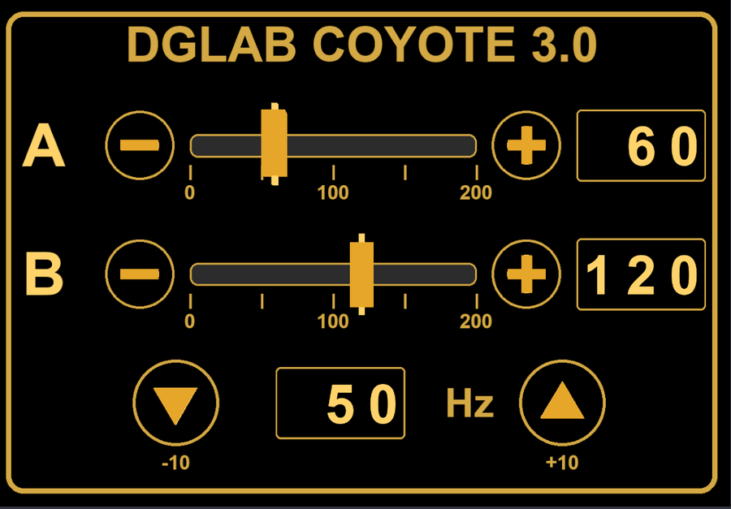

# Coyote panel for VRChat avatars

A hand-held control panel for a **DG-LAB Coyote 3.0**, built into a VRChat avatar. Two intensity sliders (A and B), −/+
buttons, and a frequency control. You grab the gold grips with PhysBones, the numbers show on the plate, and the values
reach the [coyote-vrchat PC program](../README.md) through VRChat OSC.

*A render from the Unity editor with the numbers and grips placed by hand to illustrate the layout. It is not a VRChat
screenshot: outside the game the animator does not run, so the plate shows zeros until you play.*

You install it with one menu click on the avatar you select (**Tools > Coyote Panel > Install on selected avatar**).
It is installed with [Modular Avatar](https://modular-avatar.nadena.dev/), adds one child object to your avatar and
changes nothing else on it.

> **This is hobby software, provided as is, with no warranty. It can make a real device deliver real stimulation to
> whoever wears it. Read [Safety](#safety-read-this-first) before you upload an avatar that has this panel.**
> Not affiliated with DG-LAB, VRChat or the Modular Avatar project.

**PC (Windows) only. Not tested on Quest/Android.** What has and has not been tested is listed
[at the end](#what-has-been-tested), and it is shorter than you might hope.

---

## Safety (read this first)

Everything in the safety section of the [main README](../README.md) applies: adults only,
informed consent, never put electrodes on or across the chest, head, neck or throat, start at zero and go slowly.
On top of that, this panel adds risks of its own:

- **Anyone who can grab the panel can change the intensity of whoever wears the electrodes.** The grips and buttons
  accept grabs from the wearer *and from other players*. "Lock in world" leaves the panel standing in the world so
  other people can walk up to it. Only do that with people you completely trust, and not in public instances.
- **The panel's numbers are fractions of the program's ceiling, not device units.** The panel sends `CoyoteA` =
  value ÷ 200. The PC program turns that into a fraction of **its own intensity ceiling** (200 by default). Panel value
  200 always means "the ceiling", panel value 100 means "half of it". If you lower the ceiling in the program to 80,
  panel 200 produces 80. **Set the ceiling in the program to the highest intensity you would accept from a stranger.**
- Keep the program's **rise speed limit** on, and a **STOP** within reach: the menu button (`CoyoteStop`), the program's
  STOP ALL button, and the device's own physical controls.
- The avatar never saves an intensity: all the panel's parameters have default 0 (frequency 50) and "Saved" off, so
  loading the avatar starts from zero. The program also starts every channel at zero and ramps increases.
- The numbers on the plate and the "Show panel" / "Lock in world" states are **synced**: everyone in the instance can see
  the panel and read its values.
- While the panel is installed, it writes `CoyoteA` and `CoyoteB` on every frame. **Do not also drive those two
  parameters from a radial puppet** (as in [AVATAR_SETUP.md](../docs/AVATAR_SETUP.md)): the panel overwrites them.
- Whether another player can actually grab the panel also depends on VRChat's own PhysBone/interaction rules and their
  settings. **That has not been tested** (see below), so do not assume that it is blocked either.

---

## What you get

| Control | What it does |
|---|---|
| **A** / **B** gold grips | Grab and pull along the bar: the value follows (0 at the left end, 200 at the right end). Release and the value holds. Grabbing without pulling does not change it. The grips can also be *posed* (grab, then click the trigger/click) to lock them where they are. |
| **−** / **+** buttons (per channel) | Touch = ±10, limited to 0…200. Hold to repeat every 0.35 s. |
| **▼** / **▲** (frequency) | Touch = ∓/±10 Hz, limited to 10…100 Hz. Starts at 50 Hz. |
| Plate numbers | Channel A, channel B and frequency, always readable (unlit). |
| Menu **Coyote > Show panel** | Shows/hides the panel in your hand. Showing it also puts it back in your hand if it was locked in the world. |
| Menu **Coyote > Lock in world** | The panel stays where it is (VRChat's constraint "Freeze To World"), so you can leave it standing and use both hands, or let others use it. |
| Menu **Coyote > Zero channels** | Sets A and B to 0 on the panel. |
| Menu **Coyote > STOP** | Sets `CoyoteStop`: the program's latched emergency stop (only the program window can re-enable it), and also zeroes the panel. |

The panel is 50 cm × 34 cm at Scale 1, and it is **off by default**: the "Show panel" toggle turns it on.

## Requirements

- Unity **2022.3** (the version VRChat requires) and the **VRChat Avatars SDK 3.10.2 or newer**.
- **[Modular Avatar](https://modular-avatar.nadena.dev/) 1.16.2 or newer** (installed through the VRChat Creator
  Companion).
- An avatar with a **Humanoid** rig, including the lower arm and the hand of the side you choose. Finger bones are
  recommended: they are used to work out which way the palm faces.
- The **[coyote-vrchat](../README.md) PC program**, a DG-LAB Coyote 3.0 and OSC enabled in VRChat.
- Optional: lilToon. If the project has it, the panel's black body and gold reliefs use it; otherwise they use Unity's
  built-in Standard shader.

The versions above are the ones it was developed and tested with (Unity 2022.3.22f1, SDK 3.10.2, Modular Avatar 1.16.2).
Older or newer ones might work; nobody has checked.

## Install

The package is in [`unity/io.github.eduardomv13.coyote-panel`](io.github.eduardomv13.coyote-panel). It is a standard
Unity package (it ships `.meta` files and an `.asmdef`), and it asks for the SDK and Modular Avatar in its `package.json`.

**Simplest: copy the folder.** Download this repository (**Code > Download ZIP**) or clone it, and copy
`unity/io.github.eduardomv13.coyote-panel` into the **`Packages`** folder of your avatar project (next to
`manifest.json`, `vpm-manifest.json`). Go back to Unity and let it compile. A **Tools > Coyote Panel** menu appears.
This is the way that has been tested, with the folder linked into `Packages/` (Unity reports it as an *embedded* package).

Two other ways *should* work, but **have not been tested**:

- *Unity Package Manager > + > Add package from git URL*:
  `https://github.com/eduardomv13/coyote-vrchat.git?path=/unity/io.github.eduardomv13.coyote-panel`
  (the package never writes inside its own folder, so a read-only install should be fine).
- *VRChat Creator Companion > Settings > Packages > User Packages > Add* and pick this repository's `unity` folder, then
  add "DG-LAB Coyote Panel for VRChat Avatars" to your project from its *Manage Project* page.

There is deliberately no `.unitypackage` and no VPM listing: a plain package folder is the least to maintain, it can
be read and diffed in git, and a `.unitypackage` would have to be rebuilt on every change. A VPM listing (so that the
Creator Companion could install it with a click) can be added later.

## Use it

1. In the Unity scene, **select your avatar** (the object with the *VRC Avatar Descriptor*; selecting any child also
   works).
2. **Tools > Coyote Panel > Install on selected avatar.** The console says what it did. A `Coyote Panel` child object
   appears on the avatar.
3. Check where the panel sits. Open **Tools > Coyote Panel > Options window...**, press *Show the panel in the Scene
   view*, and adjust (see [Where the panel is held](#where-the-panel-is-held)). Press *Rebuild panel on this avatar*
   after changing an option. **Switch the preview off again before you upload** (the window warns you): in the game
   the panel has to start hidden.
4. Upload or *Build & Test* the avatar as usual. Nothing else needs to be set up.
5. On the PC: start the [program](../README.md), connect the Coyote, and in VRChat turn on **Options > OSC > Enabled**.
   After the first upload of an avatar with new parameters, use **Options > OSC > Reset Config** and select the avatar
   again, as explained in [docs/AVATAR_SETUP.md](../docs/AVATAR_SETUP.md#3-turn-on-osc-in-vrchat).
6. In the game: radial menu > **Coyote > Show panel**. Start with the program's ceiling low and the electrodes **off your
   body** (or the program's `--simulate` mode), move a slider a little, and check that the program follows.

Running the install again **replaces** the panel (it deletes the old `Coyote Panel` child and rebuilds). **Tools > Coyote
Panel > Remove from selected avatar** takes it off and keeps the generated assets (the options window can delete them too).
The scene changes of an install are registered with Unity's Undo; the generated assets are not.

What the install adds to your avatar, all inside the `Coyote Panel` child object:

- Modular Avatar *Merge Animator* (the 14-layer FX controller), *Parameters*, *Menu Installer* + menu items, *Object
  Toggle* and *Bone Proxy* components;
- a `VRCParentConstraint` that follows the hand (and "Freeze To World" for the lock);
- the panel itself: 8 PhysBones, 14 renderers, 5 materials;
- generated assets in `Assets/CoyotePanel/Generated/<avatar name>/` (meshes, materials and the controller; **one folder per
  avatar**, so several avatars in one project do not overwrite each other).

If your avatar's root menu is already full (VRChat allows 8 controls), move the `Coyote` submenu with the *Install
Target* field of the Menu Installer on the `Coyote Panel/Coyote` object, or with your usual menu tool.

## Where the panel is held

The panel is attached to the hand bone and sits a little past it, on the palm side, so that you look at it with your
palm facing you. Three things decide where it ends up:

1. **Which way the palm faces and the fingers point.** *Hand direction = Auto* (the default) works this out from the
   skeleton: the forearm direction, and the index and little finger bones (little finger → index finger = toward the
   thumb, which is the panel's "up"). If the rig has no finger bones it assumes a T-pose with palms down and tells you
   in the console. If Auto gets it wrong on your rig, *Hand-bone axes* lets you say which local axis of the hand bone
   points out of the palm and which toward the fingers.
2. **The two distances**: *Toward fingers* (default 0.24 m) and *Out of palm* (default 0.08 m), measured from the hand
   bone to the center of the panel.
3. **Roll**, **Scale**, **Hand** (left/right) and **Flip facing** (plate on the back of the hand).

**These defaults were tuned by eye on one avatar** (a small avatar with a wide hoodie sleeve; 0.08 m clears that
sleeve). They are starting points, not universal values: expect to adjust them for yours. Scale multiplies the panel
*and* the two distances.

On that original avatar, *Auto* lands within 5.4° of the placement that was tuned by hand (palm direction; 2.6° for the
finger direction). *Hand-bone axes* with palm = −Z and fingers = +Y reproduces the hand-tuned placement exactly (it is
the geometry that avatar's hand bone happens to have; other rigs use other axes).

## How it talks to the PC program

The panel works through four avatar parameters, which are the contract with the PC program. If you rename them in the
program's OSC panel, rename them in the `Names` class of `Editor/PanelLayout.cs` too and rebuild the panel:

| Parameter | Type | Written by the panel as | In the program |
|---|---|---|---|
| `CoyoteA` | float | `0…1` = panel value ÷ 200, updated every frame | channel A target, as a fraction of the program's ceiling |
| `CoyoteB` | float | same, channel B | channel B |
| `CoyoteFreq` | **int**, Hz | `10…100` in steps of 10, default 50 | frequency of both channels (the program ignores 0 and non-integers) |
| `CoyoteStop` | bool | `true` while you press STOP | the latched emergency stop |

VRChat itself sends these over OSC (port 9001 on your PC) once OSC is enabled; the panel does not open any network
connection. `CoyoteA`, `CoyoteB` and `CoyoteStop` are *local-only* (OSC output is local to your own client).

### Parameter budget

The panel needs 9 avatar parameters and adds **26 bits** of synced parameter memory (VRChat's limit is 256 bits per
avatar):

| Parameter | Type | Synced | Bits |
|---|---|---|---|
| `CoyoteFreq` | int | yes | 8 |
| `CoyotePad/ValA`, `CoyotePad/ValB` (the numbers on the plate) | int | yes | 8 + 8 |
| `CoyotePad/Show`, `CoyotePad/Anchor` | bool | yes | 1 + 1 |
| `CoyoteA`, `CoyoteB`, `CoyoteStop`, `CoyotePad/Zero` | float / bool | no (local only) | 0 |

The PhysBone parameters (`CoyotePad/PbA_Stretch`, `…_IsGrabbed` and so on) are not part of the avatar's expression
parameters, so they are not synced and do not count. Measured in a built test copy: the author's avatar totals **184 / 256**
bits with the panel, and a bare sample rig **50 / 256** (26 of them from the panel).

### The FX controller (14 layers, 40 states)

All layers have Write Defaults on and are merged by Modular Avatar (*Match Avatar Write Defaults* is on, so it
converts them if your avatar uses Write Defaults off).

| Layer | Job |
|---|---|
| `CoyotePad_Mirror` | Copies the synced numbers to local floats for the display, and writes `CoyoteA = ValA/200`, `CoyoteB = ValB/200`. Loops every frame. |
| `CoyotePad_TrackA`, `_TrackB` | While a grip is grabbed, turns its PhysBone stretch into the value. |
| `CoyotePad_StepA`, `_StepB` | −/+ buttons: ±10, hold to repeat. |
| `CoyotePad_Freq` | ▼/▲: ±10 Hz, 10…100. |
| `CoyotePad_Clamp` | Safety clamp at 200. |
| `CoyotePad_Zero` | "Zero channels" and STOP set A and B to 0. |
| `CoyotePad_ShowReset` | "Show panel" clears the world lock. |
| `CoyotePad_Anchor` | "Lock in world": animates `FreezeToWorld` on the constraint. |
| `CoyotePad_PressA`, `_PressB`, `_PressF` | The button "click" (blendshapes on the plate mesh). |
| `CoyotePad_Display` | Direct blend trees that move the digits (texture offset) and the value markers. |

Two VRChat quirks the controller is built around, so you do not trip on them if you edit it: animating a vector
property (`material._MainTex_ST`, `m_LocalPosition`) needs **all** its components or the missing ones become 0, and a
transition with **no condition and no exit time** is stripped by the avatar build (the Mirror layer uses exit time 0
and duration 0 to loop).

Performance cost, as built: 8 PhysBone components (16 bone transforms), 14 renderers with 5 materials, about 5 MB of
texture memory (two uncompressed textures, no mipmaps, so the thin digits stay sharp), and the controller's 14 layers.

## What has been tested

**Tested by the author, in VRChat (PC, desktop, the author's own avatar, 2026-10-16):** the panel shown in the hand;
grabbing a grip with the mouse and dragging it changes the value; that value reaches the PC program through OSC (the
slider path: `CoyoteA`/`CoyoteB` = value ÷ 200). The program side has also been tested with a real Coyote 3.0 (see the
main README).

**Checked without VRChat (this is what the version in this repository was verified with):**

- The controller built by this package is identical to the one built by the original, single-avatar builder (0
  differences in 14 layers, 40 states, 23 parameters, all transitions, drivers and blend trees), and so are the
  hierarchy, the meshes and the hand placement (with *Hand-bone axes*).
- An offline simulator ([`Tools~/simulate_controller.py`](io.github.eduardomv13.coyote-panel/Tools~/simulate_controller.py))
  replays the controller and passes **46 checks** (dragging, holding, −/+, frequency limits, zero/stop, the lock, digits
  0…200, `CoyoteA = value/200` after load). A deliberately broken controller (a Mirror transition with no exit time, the
  bug that once stopped the slider from reaching the program) fails 11 of them. It tests the *logic*, with VRChat's
  animator semantics as we understand them; it is not VRChat.
- A VRCFury *Build an Editor Test Copy* (which runs the Modular Avatar/NDMF build) of the author's avatar and of a bare
  sample rig: 858 animation bindings, 0 unresolved, all vector components present, the Mirror layer's transitions
  survive the build, 14 layers, the parameter counts above, the menu items in place.
- A fresh, never-touched avatar (the VRChat SDK's "Robot Avatar" sample rig, in a scratch scene that was not saved):
  installed with the default options, left and right hand, flip, roll and scale, then removed, and the placement looked
  at in the editor.
- The tests in this repository (`tests/test_unity_package.py`) check the package metadata, that every asset has a
  `.meta` file, that the layout numbers in the C# and in the texture script agree, and that the simulator passes on the
  example export (`Tools~/ctrl.example.json`).

**Not tested (so treat all of this as unknown):**

- **Other players** grabbing the panel, and the lock in the world for other players: who can grab, whether a player who
  joins after the panel was locked sees it in the right place, and what the synced values look like to them. This is
  the point of the "Lock in world" feature and it has not been tried.
- **Grabbing with VR hands.** The author tested on desktop with the mouse.
- Anything in VRChat on **any avatar other than the author's**, **the right hand** in the game, and avatars with **Write
  Defaults off** (the build converts the states, which was checked in the editor, not in the game).
- In the game, separately: the **−/+ buttons**, the **frequency arrows**, **Lock in world** and posing a grip. (Earlier
  versions of the arrows did not work and were rebuilt; the sliders are the part that was confirmed.)
- **Quest/Android.** The panel uses PhysBones, a constraint and built-in unlit shaders that were never checked for Quest.
  Upload PC only, or remove the panel from the Quest variant.
- Other **Unity, SDK or Modular Avatar versions**, the two other install methods above, and the Standard-shader fallback
  (when lilToon is not in the project).
- Whether the hand placement suits other avatars: the numbers were tuned on one. Check them in the Scene view.

## Troubleshooting

| Symptom | What to do |
|---|---|
| *Tools > Coyote Panel* is missing | The package did not compile: look for red errors in the console. Check you have the SDK and Modular Avatar at the versions above. |
| "needs a Humanoid rig" / "no hand bone" | Set the avatar's rig to Humanoid and map the hand and lower-arm bones. |
| The panel is in the wrong place or upside down | Use the options window: Hand, distances, Roll, Flip facing, or *Hand-bone axes*. Rebuild, and check in the Scene view. |
| The panel is always visible in the game | You left the preview on. Turn off `Coyote Panel/Container/Content` (the options window has a button) and upload again. |
| In the game the panel moves but nothing reaches the program | OSC enabled? **Options > OSC > Reset Config**, then select the avatar again. Is the program running and showing "OSC: receiving"? See [docs/AVATAR_SETUP.md](../docs/AVATAR_SETUP.md). |
| `CoyoteA`/`CoyoteB` jump back to 0 or flicker | Something else also writes them (for example a radial puppet). Remove it: the panel owns those two parameters. |
| "Parameter memory exceeded" on upload | The panel adds 26 bits. Free some elsewhere, or remove the panel. |
| The Coyote submenu is not in the radial menu | The root menu is probably full (8 controls). Move the `Coyote` submenu (Install Target on its Menu Installer). |
| The digits look blurry | The two textures were re-imported with other settings. In the Project window select the package's `Textures/*.png`: Mip Maps off, Wrap Mode Clamp, Compression None. |

## For developers

- Code: [`Editor/`](io.github.eduardomv13.coyote-panel/Editor). `CoyotePanelInstaller` is the public entry point
  (`Install(GameObject avatar, CoyotePanelOptions options)`); `HandFrame` finds the hand directions; `PanelAssets` builds
  the meshes and materials; `PanelController` builds the animator controller; `PanelLayout` holds every number.
- **Tools > Coyote Panel > Developer > Export FX controller JSON...** dumps the controller of the selected avatar's panel;
  `python Tools~/simulate_controller.py ctrl.json` replays it.
- The plate and digit textures are drawn by [`Tools~/make_textures.py`](io.github.eduardomv13.coyote-panel/Tools~/make_textures.py)
  (needs Pillow; `--font` picks the font). If you change a layout number in `PanelLayout.cs`, change it there too: the
  repository's tests fail if the two disagree. The shipped PNGs were drawn with Arial Bold; any bold font gives the same
  layout, so if you prefer an open font (for example Inter Bold, SIL OFL), regenerate them.
- Run `python -m unittest` in the repository root.

## License

[MIT](../LICENSE), like the rest of this repository.
